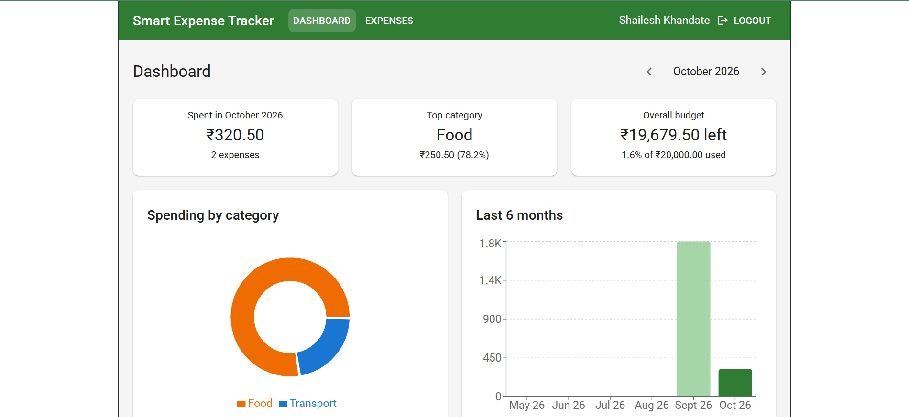

# Smart Expense Tracker

A full-stack personal finance app to track expenses, set monthly budgets and see spending insights. Built with a FastAPI REST API, MongoDB and a React dashboard.



## Features

- Register and log in with JWT authentication (Argon2 password hashing)
- Add, edit, delete and list expenses, with category and date filters and pagination
- Monthly budgets, overall or per category, with on track / close to limit / over budget status
- Dashboard with category breakdown, 6-month trend and budget progress
- Every user can only access their own data

## Tech stack

| Layer | Technology |
|---|---|
| Backend | Python, FastAPI, Pydantic |
| Database | MongoDB (aggregation pipelines, unique and compound indexes) |
| Auth | JWT (PyJWT), Argon2 |
| Frontend | React (Vite), Material UI, Recharts, Axios |
| Testing | pytest |

## Architecture

```
React (Vercel)  --HTTPS + JWT-->  FastAPI (Render)  --->  MongoDB Atlas
```

<!--## Run with Docker (quickest)

```bash
git clone https://github.com/<your-username>/<repo>.git
cd <repo>
cp .env.example .env        # then put a real SECRET_KEY in .env
docker compose up --build
```
-->

- App: http://localhost:3000
- API docs (Swagger): http://localhost:8000/docs

<!-- ## Run locally without Docker -->

**Backend** (needs Python 3.12 and a MongoDB instance)

```bash
cd backend
python -m venv venv && source venv/bin/activate   # Windows: venv\Scripts\activate
pip install -r requirements.txt
cp .env.example .env                              # fill in the values
uvicorn app.main:app --reload
```

**Frontend** (needs Node 20+)

```bash
cd frontend
npm install
cp .env.example .env
npm run dev
```

## Environment variables

| Variable | Where | Description |
|---|---|---|
| `MONGO_URL` | backend | MongoDB connection string |
| `DB_NAME` | backend | Database name |
| `SECRET_KEY` | backend | JWT signing key, at least 32 random characters |
| `CORS_ORIGINS` | backend | Comma-separated allowed frontend origins |
| `VITE_API_URL` | frontend | Base URL of the API |

## API overview

Full interactive docs at `/docs`. A saved copy is in [`docs/openapi.json`](docs/openapi.json) and a Postman collection is in [`docs/postman_collection.json`](docs/postman_collection.json).

| Method | Endpoint | Description |
|---|---|---|
| POST | `/auth/register` | Create an account |
| POST | `/auth/login` | Get a JWT |
| GET | `/auth/me` | Current user |
| POST / GET | `/expenses` | Create / list (filters: `category`, `start_date`, `end_date`, `skip`, `limit`) |
| GET / PATCH / DELETE | `/expenses/{id}` | Read / partially update / delete |
| PUT / GET | `/budgets` | Set (upsert) / list budgets (`month`) |
| DELETE | `/budgets/{id}` | Delete a budget |
| GET | `/analytics/category-summary` | Spending per category for a month |
| GET | `/analytics/monthly-trend` | Totals for the last N months |
| GET | `/analytics/budget-status` | Budget vs actual per budget |
| GET | `/health` | Health check |

## Testing

```bash
cd backend
pytest -v
```

[N] integration tests cover auth, validation, pagination, authorization (users cannot access each other's data) and analytics. They run against a separate test database and on every push via GitHub Actions.

## Design decisions

- **User-scoped queries:** every database query includes the user's id, so a guessed ID returns 404 instead of leaking data.
- **Budgets as upserts:** a unique index on user + month + category guarantees one budget per slot, even under concurrent requests.
- **Aggregation in the database:** totals, percentages and trends are computed with MongoDB pipelines, not in Python or the browser.
- **Consistent errors:** one error format for validation (422), auth (401), conflicts (409) and not found (404).

## Possible improvements

- Store money as integer paise or `Decimal128` instead of floats
- Refresh tokens and httpOnly cookies instead of localStorage
- Recurring expenses and CSV export
- Rate limiting on the auth endpoints
